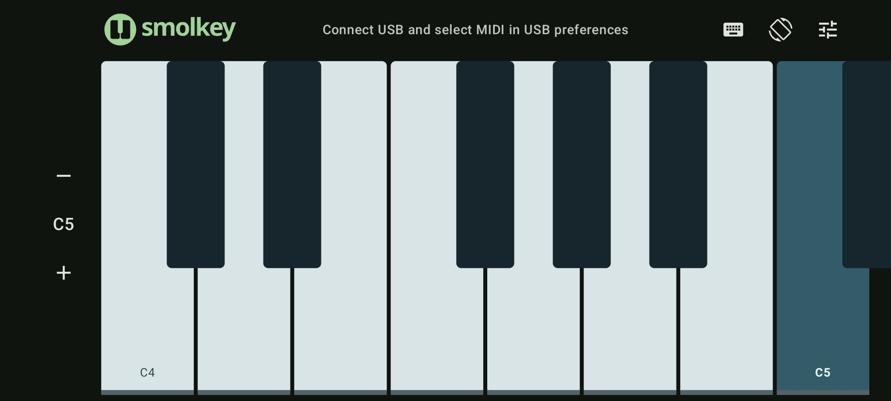
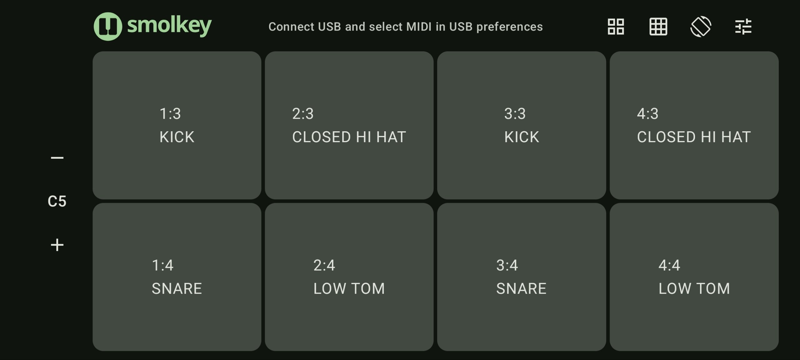
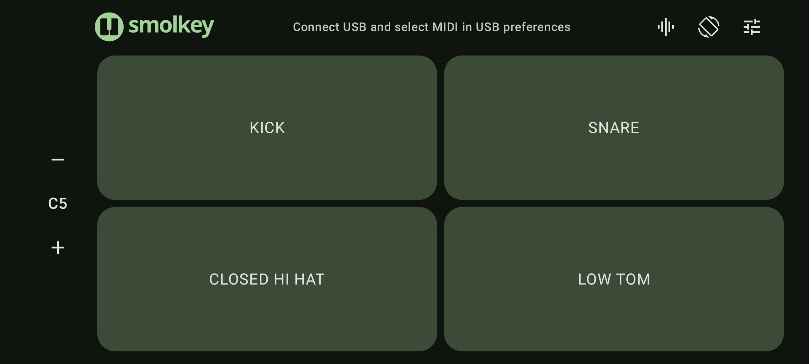
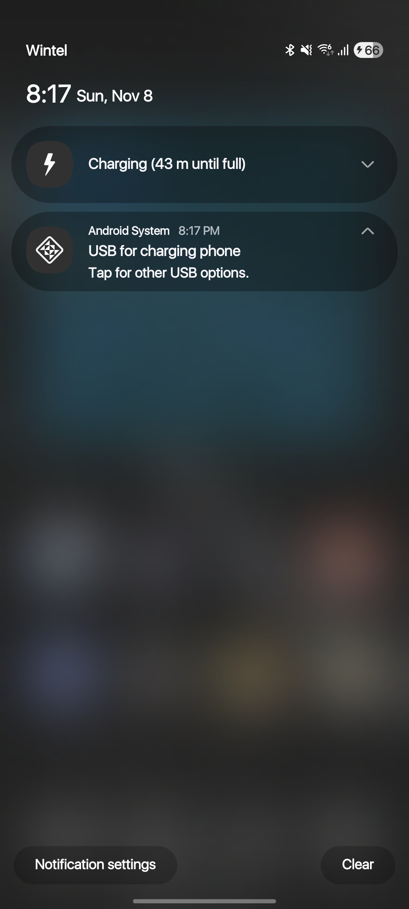
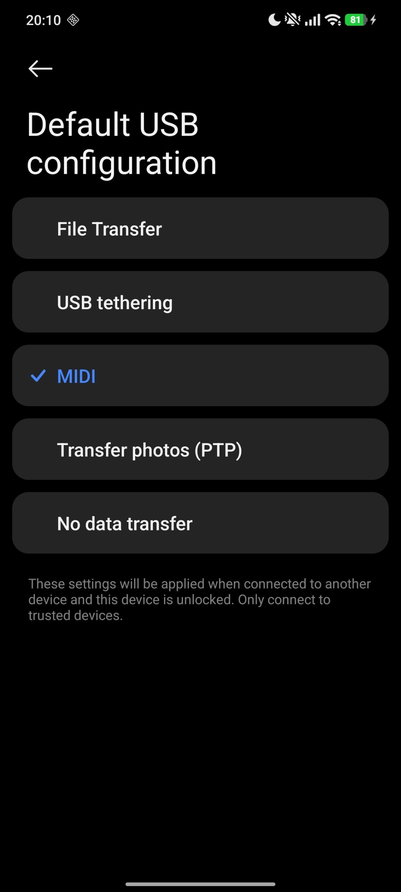
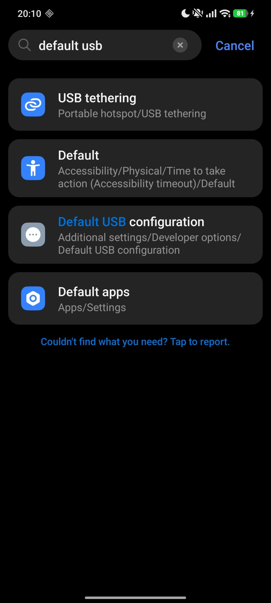
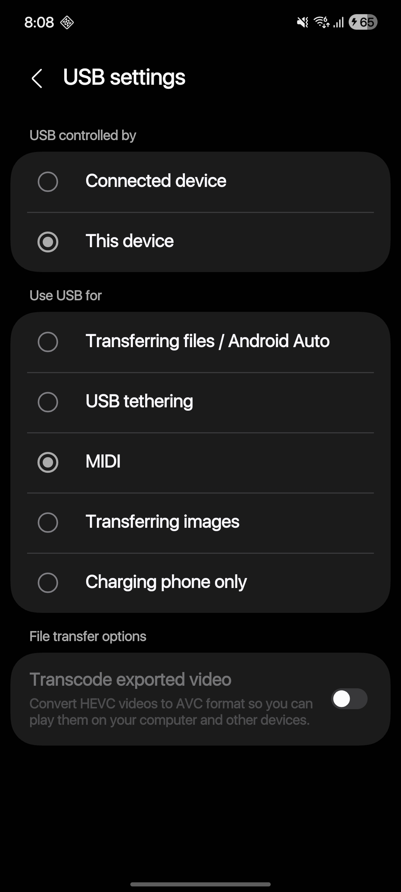

<h1>

</h1>

Smolkey turns an Android phone into a playable piano and a USB or Bluetooth MIDI controller.

 

Smolkey is beyond a touch piano. It support multiple instruments such as:

- Piano, as is
- Launchpad: to support drum and macros
- Drumpad: support fluent drum hits with any beat and any gesture
- Tambourine: expansion to drumpad with shaking to play tremolo (very WIP)

Smolkey is also native to Android's Material design and styles with "Material You" out of the box.

## Screenshots

<figure>
<figcaption>
The piano
</figcaption>
</figure>

<figure>
<figcaption>
The launchpad in upper-half mode
</figcaption>
</figure>

<figure>
<figcaption>
The drums
</figcaption>
</figure>

## Feels the key

Instrument using surface provides a tactile midi register, not just to play but to also feel it accurately.

## Launchpad layout

You can use multiple (most at 2 or more) phones or tab to build a matrix of button.

## Fine grained sound

`ensemble`, the sound engine provides a crisp piano sampling at a fraction of latency when hook up to actual MIDI.

## Two way MIDI

You don't get the note just sent out. MIDI can goes back to your device so you can monitor the fingering and the sound at the same time.

---

In short, this will get you most from phone instrument.

## Common setups

- USB on Any phone: 
  - Go to notification blind
  - Find and press Change USB mode
  - Set it to MIDI

| | |
|---|---|
|  |   |

- USB on Xiaomi/Redmi/POCO which uses HyperOS
  - Go to settings
  - Find Default USB...
  - Set it to MIDI

| | |
|---|---|
|  |   |

- When using with MuseScore:
  - Set the MIDI in and MIDI out both to your device
  - Turn on monitor on MIDI input and turn off monitor on Local key in settings

## Limits and caveat

- Tambourine not working stably (yet)
- Drum surface receive MIDI loopback plays normal piano

## Roadmap (maybe)

- Add few more instrument if there might
- Color customization, which hoist host-side stuff intergration, and some time indicator supporting Ableton uses.
